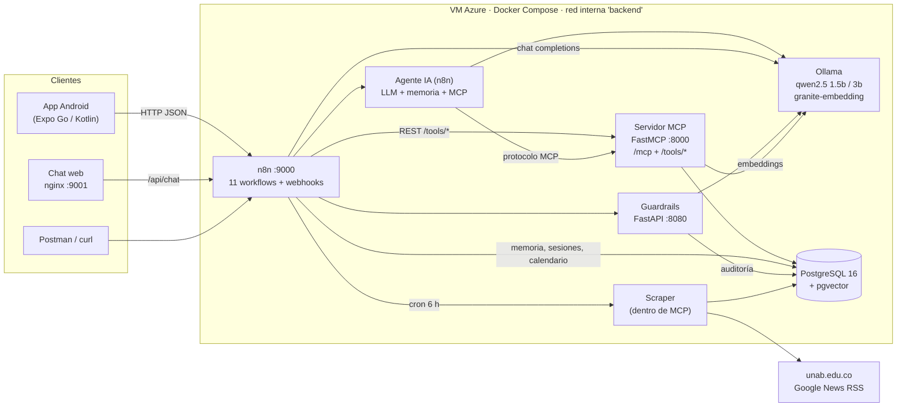
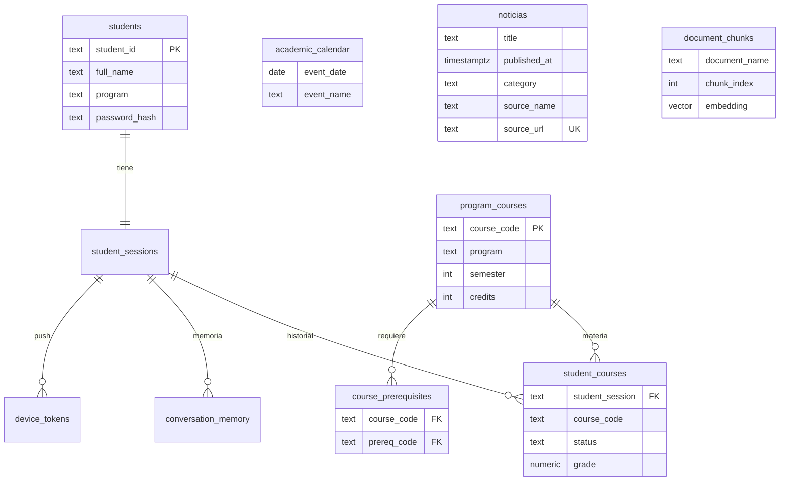

# Chatbot de Apoyo Académico UNAB

Trabajo final de **Ciencia de Datos** (Ingeniería de Sistemas, UNAB, segundo corte, tema C). Es un modelo en **n8n**
que acompaña al estudiante en la **matrícula**, su **estado académico** y su **proyección de grado**, y le da
**requisitos y recomendaciones** para tener éxito en el programa, con un enfoque de **investigación,
autoaprendizaje y educación de precisión**.

Componentes: **PostgreSQL + pgvector**, **n8n con agente IA** (LLM, memoria, herramientas MCP y guardrails),
**app móvil Android** (Expo / React Native, y la app Kotlin original), **servidor MCP** con herramientas y endpoints,
**webhooks de n8n**, **RAG** sobre el reglamento, el plan de estudios y los requisitos de grado, y un **scraper** de
noticias del día (educación, tecnología e ingeniería de sistemas). Todo corre en una VM de Azure con Docker Compose.

## Cómo se cumple la rúbrica

| Criterio (peso) | Dónde está | Evidencia |
|---|---|---|
| Arquitectura (10 %) | [Arquitectura](#arquitectura) — diagrama, flujo de datos y decisiones de diseño | Este README |
| RAG (15 %) | [RAG](#rag-recuperación-aumentada) — documentos en `data/ccd/`, chunks de 220 tokens, overlap de 30, `granite-embedding:278m` | [evidencias](docs/evidencias/README.md#servidor-mcp) (top-3 con score) |
| PostgreSQL (10 %) | `db/schema.sql`, `db/seed.sql`, `db/seed_sintetico.sql`, `db/academico.sql` — [modelo](#base-de-datos-postgresql) | [tablas con filas](docs/evidencias/README.md#base-de-datos-tablas-y-filas) |
| Workflows n8n (15 %) | `n8n/workflows/*.json` (11 workflows). Agente: `11_agente_ia_mcp.json` | [ejecuciones](docs/evidencias/README.md) |
| Servidor MCP y webhook (10 %) | `mcp-server/` (7 herramientas MCP + puente REST) y 9 webhooks — [endpoints](#endpoints-webhooks-de-n8n) | `tests/e2e/evidencias.sh` → `docs/evidencias/` |
| Scraper de noticias (10 %) | `mcp-server/app/scraper.py`, `mcp-server/sources.json`, workflow `10_scraper_noticias.json` (cada 6 h) | pestaña *Noticias* de la app, `GET /webhook/news` |
| App Android (15 %) | `mobile/` (Expo Go): chat, *Mi plan* (matrícula, estado, proyección, recomendaciones), ruta, noticias, calendario | [manual de usuario](docs/manual_usuario.md) |
| Documentación (10 %) | Este README, [manual de usuario](docs/manual_usuario.md), [capturas](#capturas) | — |
| Pertinencia pedagógica (5 %) | [Prompts](docs/prompts.md), `db/academico.sql` (recomendaciones por datos), `data/ccd/guia_exito_academico.md` | [respuestas](docs/evidencias/README.md) |

## Demo en línea (VM de Azure)

| Dirección | Qué es |
|---|---|
| **http://20.221.245.242:9001** | Chat web para estudiantes: pide el ID y responde |
| **http://20.221.245.242:9002** | Página con los QR: chat web y app en Expo Go |
| `exp://20.221.245.242:8081` | Servidor de la app para **Expo Go** (escanea el QR de la página anterior) |
| **http://20.221.245.242:9000** | n8n: interfaz de administración y webhooks (`/webhook/...`) |

> La IP es estática. Si la VM está apagada: `az vm start -g rg-chatbot-unab -n vm-chatbot-unab`; al arrancar, todo
> se levanta solo (`restart: always`). Para ahorrar crédito: `az vm deallocate -g rg-chatbot-unab -n vm-chatbot-unab`.

**Acceso a n8n:** la cuenta y la contraseña **no están en este repositorio** (es público y n8n puede ejecutar código
en el servidor). Están en `~/Chatbot-UNAB/CREDENCIALES.md` dentro de la VM (archivo ignorado por git).

### Estudiantes de prueba

El chat **no pide contraseña**: basta con el ID. Todos los datos son sintéticos: 42 estudiantes (`U00000001` a
`U00000042`) en 4 programas, 76 materias con créditos y prerrequisitos. Para `/webhook/login` la contraseña de
todos es `Unab2026*`.

| ID | Estudiante | Programa | Situación académica | Para probar |
|---|---|---|---|---|
| `U00000001` | Ana María Rojas | Ingeniería de Sistemas | Excelencia (4.45) | Carga de 21 créditos, semillero, grado 2027-2 |
| `U00000002` | Carlos Pérez | Ingeniería de Sistemas | Normal (3.78) | Matrícula de 3.er semestre, grado 2028-2 |
| `U00000010` | Camila Rojas Quintero | Administración de Empresas | En observación (3.58), 2 reprobadas | Materias por repetir, matrícula condicionada |
| `U00000009` | Samuel Pinzón Díaz | Ingeniería Industrial | Sin notas (1.er semestre) | Hábitos de autoaprendizaje |
| `U00000020` | Daniela Duarte Moreno | Ingeniería de Sistemas | 9.º semestre | Opción de grado, requisitos de grado |

### Cómo verificarlo

1. **Chat web:** abre http://20.221.245.242:9001, escribe `U00000010` y pregunta:
   - *¿Qué materias debo matricular el próximo semestre?* → matrícula según prerrequisitos y carga máxima
   - *¿Cuál es mi estado académico?* / *¿Cuándo me voy a graduar?* → estado y proyección
   - *Dame recomendaciones para tener éxito* → recomendaciones personalizadas (educación de precisión)
   - *¿Qué dice el reglamento sobre la habilitación?* → RAG sobre `data/ccd/`
   - *¿Qué noticias de tecnología hay hoy?* → noticias del scraper
   - *Recomiéndame un casino* → bloqueado por los guardrails (tema no académico)
2. **App móvil:** instala Expo Go, abre http://20.221.245.242:9002 en el PC y escanea el QR de la app.
3. **API directa:**
   ```bash
   curl "http://20.221.245.242:9000/webhook/academic-plan?student_id=U00000010"
   curl "http://20.221.245.242:9000/webhook/news?category=ingenieria-sistemas&limit=5"
   curl -X POST http://20.221.245.242:9000/webhook/chat -H 'content-type: application/json' \
        -d '{"student_id":"U00000010","message":"¿Qué materias debo matricular?"}'
   curl -X POST http://20.221.245.242:9000/webhook/agent -H 'content-type: application/json' \
        -d '{"student_id":"U00000010","message":"¿Qué materias me recomiendas matricular y cuándo me graduaría?"}'
   ```
4. **Todas las pruebas de una vez:** `BASE=http://20.221.245.242:9000/webhook ./tests/e2e/evidencias.sh`
   (guarda petición, respuesta, código HTTP y tiempo en `docs/evidencias/`).

> Las respuestas que usan el LLM tardan de 1 a 2 minutos (chat) y de 2 a 3 minutos (agente con herramientas): los
> modelos corren en la CPU de la VM, sin GPU ni API de pago, y atienden una pregunta a la vez.

## Arquitectura



### Flujo de una pregunta (`POST /webhook/chat`)

```
Webhook → validar ID/sesión (PostgreSQL) → cargar memoria (10 intercambios) → Guardrails de ENTRADA
  → intención: reglas deterministas y, si hay duda, clasificador LLM → Switch:
      consulta-general  → MCP search_documents (pgvector, top-3)            → prompt RAG
      calendario        → tabla academic_calendar                            → prompt calendario
      cursos-realizados → MCP get_student_courses                            → prompt historial
      noticias          → tabla noticias (categoría, fuente, fecha)          → prompt noticias
      plan-academico    → MCP get_academic_plan → SQL academic_plan()        → prompt consejero (educación de precisión)
  → LLM (Ollama) → Guardrails de SALIDA → guardar memoria → respuesta {response, intent}
```

El **agente** (`POST /webhook/agent`, workflow 11) resuelve lo mismo de forma autónoma: un nodo *AI Agent* de n8n
con modelo *Ollama Chat* (`qwen2.5:3b`), memoria *Postgres Chat Memory* y el nodo *MCP Client Tool* conectado a
`http://mcp-server:8000/mcp`. El LLM decide qué herramienta llamar (`get_academic_plan`, `search_documents`,
`get_academic_calendar`, `get_news`). Los guardrails validan la entrada y la salida igual que en el chat.

### Decisiones de diseño

| Decisión | Por qué |
|---|---|
| **Ruteo por intención + agente** | El ruteo con reglas y un Switch es determinista y rápido (un LLM pequeño en CPU), y es el que usa la app. El agente con MCP muestra el uso autónomo de herramientas; tarda más porque el LLM decide y llama las herramientas. |
| **Reglas académicas en SQL** (`academic_plan`) | La matrícula, el estado, la proyección y las recomendaciones salen de datos exactos (créditos, notas, prerrequisitos). El LLM solo redacta: no inventa cifras. La misma función la usan n8n, el MCP y la app. |
| **Proyección = máx(créditos ÷ carga, cadena de prerrequisitos)** | Contar solo créditos subestima el tiempo: Proyecto de Grado II no se puede ver el mismo periodo que Proyecto de Grado I. |
| **Ollama local** (`qwen2.5:1.5b` chat, `qwen2.5:3b` agente) | Gratis, sin API keys ni datos de estudiantes fuera de la VM. El de 3B llama herramientas de forma fiable; el de 1.5B responde el chat en la mitad del tiempo. |
| **PostgreSQL + pgvector en un solo motor** | Datos académicos, memoria, auditoría, noticias y vectores del RAG en la misma base: un solo respaldo y consultas SQL con joins. |
| **Servidor MCP con puente REST** | `/mcp` (protocolo MCP) para el agente y cualquier cliente MCP; `/tools/*` (REST) para los nodos HTTP de n8n, más simple de depurar. Misma lógica en ambos. |
| **Guardrails fail-closed** | Si el servicio de guardrails no responde, se devuelve el mensaje de respaldo, nunca la respuesta sin validar. |
| **Solo n8n y las páginas web publican puertos** | MCP (8000), guardrails (8080), Ollama (11434) y PostgreSQL quedan en la red interna de Docker. SSH solo desde la IP del administrador. |
| **Calendario en PostgreSQL** (antes Google Sheets) | No depende de una cuenta de servicio de Google; Sheets sigue disponible en el generador de workflows. |

## RAG (recuperación aumentada)

**Documentos** (`data/ccd/`, se ingieren con `docker compose exec mcp-server python -m app.cli ingest`):

| Documento | Contenido | Chunks |
|---|---|---|
| `reglamento_estudiantil.md` | Matrícula, carga de créditos, prerrequisitos, evaluación, habilitación, supletorios, situación académica, estímulos | 8 |
| `plan_estudios_ingenieria_sistemas.md` | 22 materias por semestre con créditos y prerrequisitos (generado del catálogo de la BD), rutas de formación | 7 |
| `requisitos_de_grado.md` | Requisitos de grado, opciones de grado, cómo se calcula la proyección | 4 |
| `guia_exito_academico.md` | Educación de precisión, autoaprendizaje, investigación, servicios de apoyo, recomendaciones por etapa | 5 |

> Son documentos de referencia escritos para el proyecto y coherentes con las reglas de la base de datos. Para usar
> los documentos oficiales de la UNAB, copia los PDF o DOCX en `data/ccd/` y vuelve a ejecutar la ingesta.

**Pipeline:** extracción (`pdfplumber`, `python-docx`, texto/Markdown) → chunking por tokens (`tiktoken`
cl100k) → embeddings (Ollama) → `INSERT ... ON CONFLICT` en `document_chunks` (`vector(1536)`, índice HNSW coseno)
→ consulta: embedding de la pregunta → top-k por similitud coseno → contexto numerado en el prompt.

| Parámetro | Valor | Justificación |
|---|---|---|
| Tamaño del chunk | **220 tokens** (`CHUNK_MAX_TOKENS`) | Un artículo del reglamento tiene de 80 a 200 tokens: cada chunk trae 1 o 2 artículos completos, una unidad de sentido. En el tokenizador de granite (XLM-R) 220 tokens cl100k son unos 280, por debajo de su límite de 512 (no se trunca). Chunks más largos diluyen la similitud y alargan el prompt en CPU. |
| Overlap | **30 tokens** (~14 %) | Conserva la frase de transición entre artículos para que una regla partida entre dos chunks se recupere entera. Más overlap duplica texto en el top-k. |
| Modelo de embeddings | **`granite-embedding:278m`** (IBM, multilingüe, 768 dims, Apache 2.0) | Entrenado para recuperación en español, entre otros idiomas. Corre en CPU con Ollama (gratis). Se rellena a 1536 dims con ceros, lo que no cambia la similitud coseno, para poder cambiar a `text-embedding-3-small` sin migrar la tabla. |
| top-k | **3** (`RAG_TOP_K`) | Con 24 chunks, 3 fragmentos (máx. 600 caracteres cada uno) cubren la respuesta y mantienen el prompt corto. |
| Índice | **HNSW** coseno | `ivfflat` con pocas filas devuelve menos de top-k resultados. |

Ejemplo real de recuperación (*"¿Cuándo se puede habilitar una materia?"*): ver
[docs/evidencias](docs/evidencias/README.md#servidor-mcp). El primer resultado (similitud 0.74) es el chunk 3 del
reglamento, que contiene los artículos 8 (supletorio) y 9 (habilitación).

## Base de datos (PostgreSQL)

Scripts (en este orden; el `docker-compose.override.yml` los ejecuta solos en una base nueva):

| Script | Qué crea |
|---|---|
| `db/schema.sql` | `students`, `student_sessions`, `student_courses`, `document_chunks` (pgvector), `conversation_memory` (+ trigger de 50 intercambios), `noticias`, `guardrails_audit_log`, `device_tokens`, `notifications_sent` y funciones (`login_student`, `validate_session`, `session_by_student`, `get_recent_history`, `save_exchange`, `pending_notifications`) |
| `db/seed.sql` | 2 estudiantes de demostración con historial |
| `db/seed_sintetico.sql` | `program_courses` (76 materias con créditos en 4 programas) y 40 estudiantes con historial |
| `db/academico.sql` | `course_prerequisites`, `academic_calendar`, columnas `category` y `source_name` en `noticias`, funciones `academic_term()` y `academic_plan()` |



`academic_plan(session_id)` devuelve en JSON: **estado** (promedio ponderado por créditos, créditos aprobados,
situación: excelencia / normal / en observación / prueba académica), **matrícula sugerida** del próximo periodo
(materias reprobadas primero, prerrequisitos aprobados o en curso, carga máxima de 12, 18 o 21 créditos según la
situación), **materias bloqueadas**, **proyección** (créditos y periodos restantes, periodo estimado de grado) y
**recomendaciones** calculadas con los datos del estudiante.

Ver las tablas con datos en la VM:

```bash
docker compose exec db psql -U postgres -d chatbot -c "\dt+"
docker compose exec db psql -U postgres -d chatbot -c "SELECT jsonb_pretty(academic_plan('sess_u00000010'))"
```

## Servidor MCP

`mcp-server/` (FastMCP 4, Python). Protocolo MCP en `http://mcp-server:8000/mcp` (streamable HTTP) y puente REST
en `/tools/<herramienta>`. Solo es accesible dentro de la red de Docker.

| Herramienta | Entrada | Devuelve |
|---|---|---|
| `search_documents` | `query`, `top_k` | Chunks más similares con `document_name`, `chunk_index`, `similarity_score` |
| `get_student_courses` | `session_id` | Cursos aprobados, en curso y pendientes, con notas y avance |
| `get_academic_plan` | `student_id` o `session_id` | Estado, matrícula sugerida, proyección y recomendaciones (texto para el agente; JSON por REST) |
| `get_academic_calendar` | `upcoming_only` | Eventos del calendario académico |
| `get_news` | `category`, `limit`, `today_only` | Noticias con título, resumen, fuente, categoría y fecha |
| `ingest_documents` | `file_paths` (opcional) | Reporte de ingesta (documentos, chunks, embeddings, errores) |
| `run_news_scraper` | `sources` (opcional) | Reporte del scraper por categoría |

El nodo *MCP Client Tool* de n8n agrega al llamar una herramienta argumentos que esta no declara (`toolCallId` y
los campos del ítem de entrada). `main.py` tiene un middleware que los descarta antes de validar.

## Scraper de noticias

`mcp-server/app/scraper.py` lee las fuentes de `mcp-server/sources.json`:

- **HTML** del sitio de la UNAB (noticias y educación continua), con selectores CSS.
- **RSS de Google News** con tres búsquedas del día: ingeniería de sistemas / desarrollo de software, tecnología e
  inteligencia artificial en Colombia, y educación superior en Colombia.

Cada noticia se clasifica por palabras clave en `ingenieria-sistemas`, `tecnologia`, `educacion` o `general`. De las
fuentes externas se descartan las de `general`. Se guarda con **fuente** (`source_name`, el medio) y **fecha de
publicación**, sin duplicados (`source_url` único). n8n lo ejecuta **cada 6 horas** (workflow 10). La app lo muestra en
la pestaña *Noticias* con filtro por categoría, y el chat y el agente lo consultan.

## Endpoints (webhooks de n8n)

| Método | Ruta | Uso |
|---|---|---|
| POST | `/webhook/student-lookup` | `{student_id}` → `{student_id, full_name, program, current_semester, progress_percentage}` (404 si no existe) |
| POST | `/webhook/chat` | `{student_id, message}` (o Bearer del login) → `{response, intent}` |
| POST | `/webhook/agent` | `{student_id, message}` → `{response, agent: true}` (agente IA con herramientas MCP) |
| GET | `/webhook/academic-plan` | `?student_id=` → `{student, status, enrollment, projection, recommendations}` |
| GET | `/webhook/academic-route` | `?student_id=` (o Bearer) → `{courses[], progress_percentage}` |
| GET | `/webhook/news` | `?category=educacion\|tecnologia\|ingenieria-sistemas&limit=&today=1` → `{news[]}` |
| GET | `/webhook/calendar` | `?student_id=` (o Bearer) → `{events[]}` |
| POST | `/webhook/login` | `{student_id, password}` → `{token, session_id, expires_at, full_name}` |
| POST | `/webhook/register-device` | `{fcm_token}` + Bearer → `{ok}` |

Workflows sin webhook: `06` notificaciones push (cada hora) y `10` scraper de noticias (cada 6 h).

El backend **ignora el `session_id` del cuerpo** y usa el asociado al token o al ID. **Modo demo:** con solo el ID,
cualquiera que conozca un ID puede ver los datos de ese estudiante. Es aceptable porque los datos son sintéticos; en
producción hay que usar el login.

## Capturas

Capturas del sistema desplegado en la VM de Azure (`docs/img/`), en el orden en que lo recorre un usuario.

### Portal: todas las herramientas en un solo lugar

Punto de entrada del proyecto, con accesos al chat web, la app móvil, el plan académico, las noticias, n8n y la
bandeja de correo de prueba.


### Chat web para estudiantes

El asistente saluda, pide el ID de estudiante y responde sobre matrícula, estado académico, proyección de grado,
reglamento, calendario, noticias y envíos por correo.


### App móvil (Expo Go)

Página con los códigos QR para abrir el chat web en el navegador del celular o la app nativa en Expo Go.


### Plan académico

Estado académico, proyección de grado y matrícula sugerida según prerrequisitos y créditos (ejemplo: `U00000010`,
estudiante en observación con materias por repetir).


### Noticias de la UNAB

Noticias de educación, tecnología e ingeniería de sistemas que recoge el scraper cada 6 horas, con imagen, fuente
y fecha.


### Envíos por correo

Bandeja de prueba (Mailpit) con los informes de avance y las noticias que el asistente envía cuando el estudiante
lo pide desde el chat.


### Administración en n8n

Los 11 workflows activos del proyecto: agente IA con MCP, scraper de noticias, plan académico, búsqueda de
estudiantes, chat con ruteo y notificaciones.


## Estructura

| Carpeta | Contenido |
|---|---|
| `docker-compose.yml`, `docker-compose.override.yml`, `.env.example` | Infraestructura: n8n, mcp-server, guardrails, ollama, db (PostgreSQL + pgvector), web (nginx), expo |
| `db/` | Esquema, datos sintéticos y módulo académico (`academico.sql`) |
| `data/ccd/` | Documentos del RAG (reglamento, plan de estudios, requisitos de grado, guía de éxito académico) |
| `mcp-server/` | Servidor FastMCP: RAG, plan académico, calendario, noticias, ingesta y scraper |
| `guardrails/` | FastAPI: `/validate-input` (prompt injection, tema) y `/validate-output` (alcance) + auditoría |
| `n8n/workflows/*.json` | 11 workflows importables; `n8n/build_workflows.py` los genera y `n8n/code/lib.js` tiene la lógica JS probada |
| `mobile/` | **App Android** (Expo / React Native, se ejecuta en Expo Go) |
| `android/` | App Android nativa original (Kotlin); requiere Android Studio |
| `web/` | Chat web y página de QR (nginx) |
| `scripts/` | `azure/crear_vm.sh` (VM con Azure CLI), `setup_n8n.py` (credenciales + workflows), `run_tests.sh` |
| `tests/` | Integración (SQL, lógica JS de n8n), smoke test y `e2e/evidencias.sh` |
| `docs/` | [Manual de usuario](docs/manual_usuario.md), [prompts](docs/prompts.md), [evidencias](docs/evidencias/README.md), requisitos y diseño |

## Instalación

### 1. VM en Azure con la CLI

`scripts/azure/crear_vm.sh` crea el grupo de recursos, una VM Ubuntu 24.04 `Standard_B2as_v2` (2 vCPU, 8 GB),
disco StandardSSD de 64 GB, IP pública estática y reglas de NSG: 22 solo desde tu IP y 9000, 9001, 9002 y 8081
para la app. Úsalo con una suscripción en la que tengas rol *Owner* o *Contributor*:

```bash
az login
SUBSCRIPTION=<id-de-tu-suscripcion> ./scripts/azure/crear_vm.sh
```

> Azure for Students solo permite algunas regiones (aquí `northcentralus`) y 3 IPs públicas por suscripción.

### 2. Backend en la VM

```bash
sudo apt update && sudo apt install -y docker.io docker-compose-v2 python3 git
sudo usermod -aG docker $USER && newgrp docker
git clone <tu-repo> ~/Chatbot-UNAB && cd ~/Chatbot-UNAB
cp .env.example .env && nano .env        # IP pública, claves, POSTGRES_PASSWORD, WEB_BIND=0.0.0.0
docker compose up -d --build             # PostgreSQL con todos los scripts SQL, Ollama y sus modelos (~3.5 GB)
python3 scripts/setup_n8n.py --activate  # credenciales cifradas, importa y activa los 11 workflows
docker compose exec mcp-server python -m app.cli ingest   # RAG: documentos de data/ccd/
docker compose exec mcp-server python -m app.cli scrape   # primera carga de noticias
```

Variables clave del `.env` para una VM con IP pública (sin dominio):

| Variable | Ejemplo | Para qué |
|---|---|---|
| `N8N_HOST`, `WEBHOOK_URL` | `20.221.245.242`, `http://20.221.245.242:9000/` | URL pública de n8n |
| `SUPABASE_DB_URL`, `DB_SSL` | `postgresql://postgres:<clave>@db:5432/chatbot`, `disable` | PostgreSQL local del override |
| `WEB_BIND` | `0.0.0.0` | Publica el chat web (9001), los QR (9002) y Expo (8081). `127.0.0.1` si usas un túnel |
| `EXPO_PUBLIC_URL`, `EXPO_API_URL` | `http://<ip>:8081`, `http://<ip>:9000/webhook` | URLs que ve la app en Expo Go |
| `AGENT_LLM_MODEL`, `OLLAMA_MAX_LOADED_MODELS` | `unab-agent`, `3` | Modelo del agente (`qwen2.5:3b`) |
| `OLLAMA_CONTEXT_LENGTH` | `8192` | El agente con herramientas necesita más contexto |

El modelo del agente se crea una vez:

```bash
docker compose exec ollama sh -c 'ollama pull qwen2.5:3b && printf "FROM qwen2.5:3b\nPARAMETER num_thread 2\n" > /tmp/M && ollama create unab-agent -f /tmp/M'
```

### 3. App móvil (Expo Go)

El contenedor `expo` sirve la app en el puerto 8081. En el celular: instala **Expo Go**, abre
`http://<ip>:9002` en el PC y escanea el QR. Para desarrollo local: `cd mobile && npm install && npx expo start`.
Detalles en `mobile/README.md` y en el [manual de usuario](docs/manual_usuario.md).

### Opcional: Supabase, Google Sheets y Firebase

- **Supabase** en lugar del PostgreSQL local: ejecuta los 4 scripts de `db/` en el SQL Editor, pon la cadena de
  conexión en `SUPABASE_DB_URL` con `DB_SSL=require` y borra `docker-compose.override.yml`.
- **Firebase Cloud Messaging** (push en la app Kotlin): `google-services.json` en `android/app/`, `FCM_PROJECT_ID` y
  `GOOGLE_SA_JSON` con el rol *Firebase Cloud Messaging API Admin*.

## Pruebas

```bash
./scripts/run_tests.sh                       # Python: mcp-server, guardrails, integración
docker compose exec expo npm test            # lógica de la app (node --test)
BASE=http://<ip>:9000/webhook ./tests/e2e/evidencias.sh        # e2e de todos los webhooks (+ --mcp en la VM)
```

Las 24 propiedades de corrección del diseño tienen su test (`Feature: chatbot-apoyo-academico, Property N`).
Las nuevas pruebas (`mcp-server/tests/test_news_and_plan.py`) cubren la clasificación de noticias, el parser RSS,
el middleware de argumentos MCP y el resumen del plan académico.

## Decisiones respecto al diseño original

- **`SUPABASE_DB_URL`**: asyncpg necesita la cadena PostgreSQL; `SUPABASE_URL/KEY` (REST) no sirven para conectarse.
- **Índice HNSW** en lugar de ivfflat: ivfflat con `lists=100` y pocas filas devuelve menos de top-k resultados.
- **`session_id` estable por estudiante**: el login rota el token pero conserva el `session_id`; así la memoria y
  los cursos persisten entre sesiones. La retención de 50 intercambios la hace un trigger.
- **Un workflow de chat con ramas** en vez de sub-workflows: importa sin reconfigurar IDs.
- **n8n llama al servidor MCP por un puente REST** (`/tools/*`) en el chat, y por el **protocolo MCP** en el agente.
- **Tolerancia a errores de ingesta por documento** y **guardrails fail-closed**.
- **Plan académico, calendario y noticias por categoría** (`db/academico.sql`): agregados para cubrir matrícula,
  estado académico, proyección y recomendaciones, sin depender de Google Sheets.
