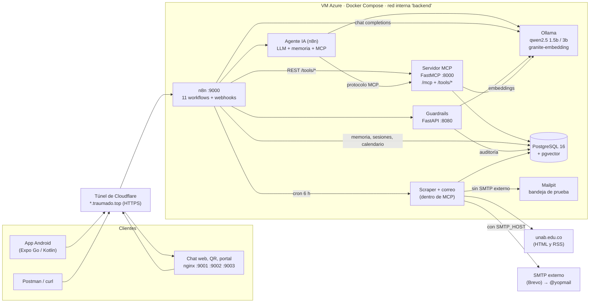
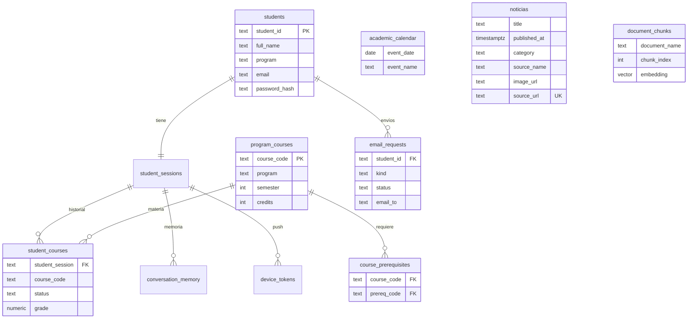
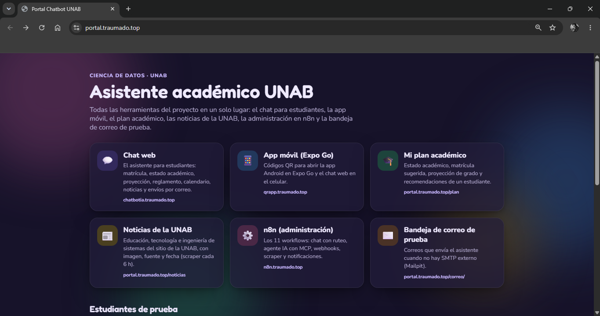
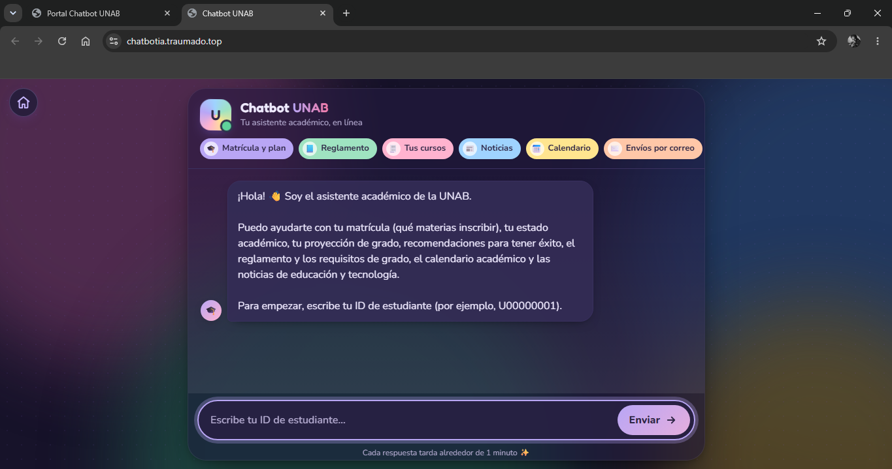
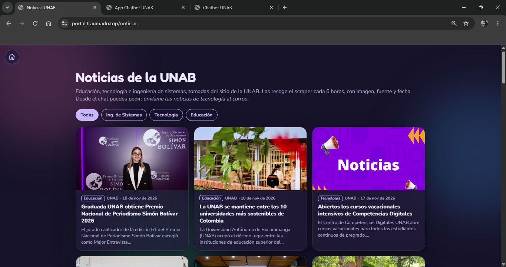
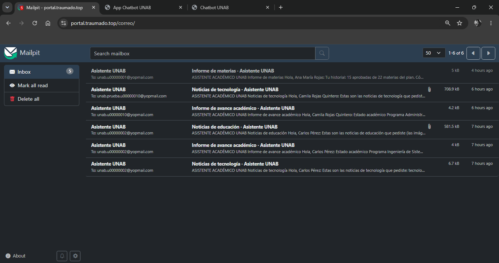
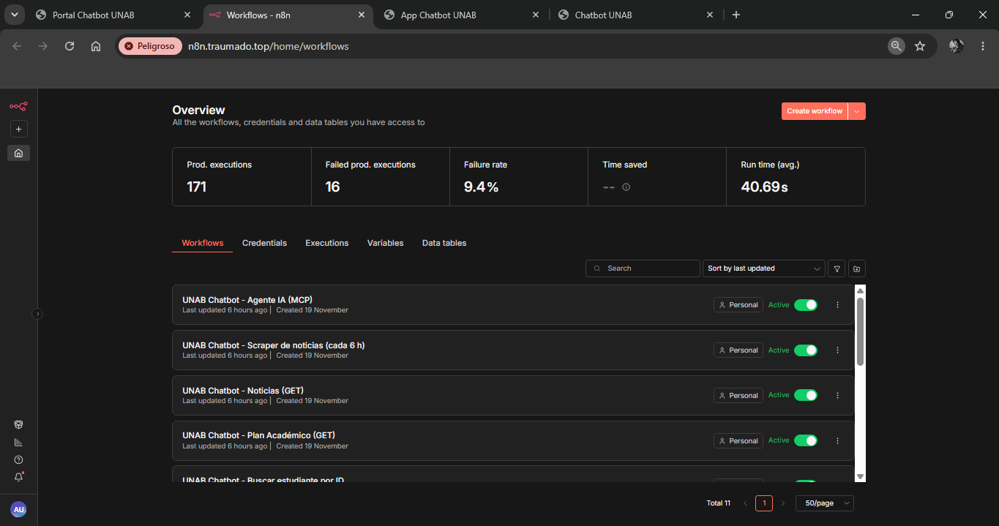

# Chatbot de Apoyo Académico UNAB

Trabajo final de **Ciencia de Datos** (Ingeniería de Sistemas, UNAB, segundo corte, tema C). Es un modelo en **n8n**
que acompaña al estudiante en la **matrícula**, su **estado académico** y su **proyección de grado**, y le da
**requisitos y recomendaciones** para tener éxito en el programa, con un enfoque de **investigación,
autoaprendizaje y educación de precisión**.

Componentes: **PostgreSQL + pgvector**, **n8n con agente IA** (LLM, memoria, herramientas MCP y guardrails),
**app móvil Android** (Expo / React Native, y la app Kotlin original), **servidor MCP** con herramientas y endpoints,
**webhooks de n8n**, **RAG** sobre el reglamento, el plan de estudios y los requisitos de grado, un **scraper** de
noticias de la UNAB con imágenes, **envío por correo** de noticias e informes, y un **portal** con todas las
herramientas. Todo corre en una VM de Azure con Docker Compose, publicada con un túnel de Cloudflare.

## Cómo se cumple la rúbrica

| Criterio (peso) | Dónde está | Evidencia |
|---|---|---|
| Arquitectura (10 %) | [Arquitectura](#arquitectura) — diagrama, flujo de datos y decisiones de diseño | Este README |
| RAG (15 %) | [RAG](#rag-recuperación-aumentada) — documentos en `data/ccd/`, chunks de 220 tokens, overlap de 30, `granite-embedding:278m` | [evidencias](docs/evidencias/README.md#servidor-mcp) (top-3 con score) |
| PostgreSQL (10 %) | `db/schema.sql`, `db/seed.sql`, `db/seed_sintetico.sql`, `db/academico.sql` — [modelo](#base-de-datos-postgresql) | [tablas con filas](docs/evidencias/README.md#base-de-datos-tablas-y-filas) |
| Workflows n8n (15 %) | `n8n/workflows/*.json` (12 workflows). Agente: `11_agente_ia_mcp.json`; ingesta: `12_ingesta_documentos.json` | [ejecuciones](docs/evidencias/README.md) |
| Servidor MCP y webhook (10 %) | `mcp-server/` (8 herramientas MCP + puente REST), MCP público para Claude/OpenAI y 10 webhooks — [endpoints](#endpoints-webhooks-de-n8n) | `tests/e2e/evidencias.sh` → `docs/evidencias/` |
| Scraper de noticias (10 %) | `mcp-server/app/scraper.py`, `mcp-server/sources.json` (solo UNAB, con imagen), workflow `10_scraper_noticias.json` (cada 6 h) | [portal · noticias](https://portal.traumado.top/noticias), pestaña *Noticias* de la app |
| App Android (15 %) | `mobile/` (Expo Go): chat, *Mi plan* (matrícula, estado, proyección, recomendaciones), ruta, noticias, calendario | [manual de usuario](docs/manual_usuario.md) |
| Documentación (10 %) | Este README, [manual de usuario](docs/manual_usuario.md), [capturas](#capturas) | — |
| Pertinencia pedagógica (5 %) | [Prompts](docs/prompts.md), `db/academico.sql` (recomendaciones por datos), `data/ccd/guia_exito_academico.md` | [respuestas](docs/evidencias/README.md) |

### Requisitos del Tema 2 (diapositivas del curso)

| Diapositiva | Requisito | Cómo se cumple |
|---|---|---|
| 06 · Objetivo | Matrícula, avance, proyección de semestres, alertas de requisitos, recomendaciones | `academic_plan()` + `student_alerts()` (inglés B1, Saber Pro, opción de grado, insignia CCD, reprobadas, prerrequisitos) |
| 08 · Infraestructura | **AWS EC2** con puerto 9000 | **Azure VM** (aprobado por el profesor en lugar de AWS), Ubuntu 24.04, NSG con el **puerto 9000 abierto** para n8n (`http://135.232.242.188:9000/webhook/...`) |
| 08 · Infraestructura | n8n en contenedores | Docker Compose con 8 servicios |
| 08 · Infraestructura | PostgreSQL + pgvector (Supabase) con **vistas analíticas** | PostgreSQL 16 + pgvector; vistas `v_estado_estudiante`, `v_ccd_progreso`, `v_avance_programa`, `v_noticias_recientes` ([BD](#base-de-datos-postgresql)) |
| 08 · Infraestructura | Servidor MCP (FastMCP) con herramientas relacionales | `mcp-server/`, 8 herramientas sobre PostgreSQL |
| 09 · Alcance | Ruta y cursos; *¿qué es la insignia de competencias digitales?* | Plan académico + RAG con `data/ccd/centro_competencias_digitales.md` |
| 09 · Alcance | RAG institucional sobre documentos del CCD | 5 documentos, 31 chunks en pgvector |
| 09 · Alcance | Calendario (inscripciones, pruebas diagnósticas, inicio de cursos) | Tabla `academic_calendar` con las fechas del CCD (Google Sheets opcional) |
| 09 · Alcance | *¿Qué cursos de competencias digitales he tomado?* (BD sintética) | Tablas `ccd_courses`, `student_ccd_courses`, `ccd_diagnostics` + herramienta `get_ccd_progress` + intención `competencias-digitales` |
| 09 · Alcance | Noticias por scraping periódico | Scraper de la UNAB cada 6 h, con imagen |
| 10 · Componentes | Ingesta y embeddings **en n8n** | Workflow `12_ingesta_documentos` (manual y `POST /webhook/ingest`) |
| 10 · Componentes | Guardrails, memoria persistente, ruteo por intención | Servicio `guardrails`, `conversation_memory`, workflow 01 |
| 10 · Componentes | Clientes MCP: **Claude / OpenAI** | `https://mcp.traumado.top/mcp` con token ([Servidor MCP](#servidor-mcp)) |
| 11 · Workflows | Consulta general, calendario, cursos realizados, noticias | Ramas del workflow 01 (+ plan académico, correo, competencias digitales) |
| 12 · Entregables | Arquitectura, RAG, BD, workflows, scraper, app, documentación, **video** | Este README · [video de demostración](#video-de-demostración) |

**Rúbrica de la diapositiva 12:** Arquitectura 20 % · RAG 20 % · Workflows n8n 20 % · Base de datos 10 % · App
móvil 20 % · Documentación 10 %. Cada criterio está cubierto en las secciones de este README.

## Video de demostración

> 🎬 **[Ver video de demostración en YouTube](https://www.youtube.com/watch?v=A1gF0J1GTPI&feature=youtu.be).**
> El video recorre el portal, la app en Expo Go, el plan académico, el RAG
> (reglamento e insignia del CCD), los cursos de competencias digitales, las noticias, el envío por correo, los
> guardrails, los workflows de n8n y la base de datos.

## Demo en línea

Todo se publica por un túnel de Cloudflare con HTTPS; en la VM los servicios solo escuchan en `localhost`.

| Dirección | Qué es | Puerto en la VM |
|---|---|---|
| **https://portal.traumado.top** | **Inicio:** landing page con enlaces a todas las herramientas | `localhost:9003` |
| **https://chatbotia.traumado.top** | Chat web para estudiantes: pide el ID y responde | `localhost:9001` |
| **https://qrapp.traumado.top** | Página con los QR: app en Expo Go y chat web | `localhost:9002` |
| `exps://expoapp.traumado.top` | Servidor de la app para **Expo Go**. En un navegador redirige a qrapp.traumado.top | `localhost:8081` |
| **https://n8n.traumado.top** | n8n: administración y webhooks (`/webhook/...`). También `http://135.232.242.188:9000` (puerto 9000 abierto; la interfaz requiere HTTPS, úsala por el dominio) | `:9000` |
| `https://mcp.traumado.top/mcp` | Servidor MCP para **Claude Desktop / OpenAI** (requiere token) | `localhost:9004` |
| https://portal.traumado.top/noticias · /plan · /correo/ | Noticias con imagen · plan académico por ID · bandeja de correo de prueba | `localhost:9003` |

Cada herramienta web (chat, QR, noticias, plan) tiene un botón con el **icono de una casa** para volver al portal.

> Si la VM está apagada: `az vm start -g rg-chatbot-unab -n vm-chatbot-unab`; al arrancar, todo se levanta solo
> ([persistencia](#persistencia)). Para ahorrar crédito: `az vm deallocate -g rg-chatbot-unab -n vm-chatbot-unab`.

**Acceso a n8n:** la cuenta y la contraseña **no están en este repositorio** (es público y n8n puede ejecutar código
en el servidor). Están en `~/Chatbot-UNAB/CREDENCIALES.md` dentro de la VM (archivo ignorado por git).

### Estudiantes de prueba

El chat **no pide contraseña**: basta con el ID. Todos los datos son sintéticos: 42 estudiantes (`U00000001` a
`U00000042`) en 4 programas, 76 materias con créditos y prerrequisitos. Cada estudiante tiene un **correo temporal de
prueba** `unab.<id>@yopmail.com` (por ejemplo `unab.u00000010@yopmail.com`; la bandeja se ve sin registro en
https://yopmail.com). Para `/webhook/login` la contraseña de todos es `Unab2026*`.

| ID | Estudiante | Programa | Situación académica | Para probar |
|---|---|---|---|---|
| `U00000001` | Ana María Rojas | Ingeniería de Sistemas | Excelencia (4.45) | Carga de 21 créditos, semillero, grado 2027-2 |
| `U00000002` | Carlos Pérez | Ingeniería de Sistemas | Normal (3.78) | Matrícula de 3.er semestre, grado 2028-2 |
| `U00000010` | Camila Rojas Quintero | Administración de Empresas | En observación (3.58), 2 reprobadas | Materias por repetir, matrícula condicionada |
| `U00000009` | Samuel Pinzón Díaz | Ingeniería Industrial | Sin notas (1.er semestre) | Hábitos de autoaprendizaje |
| `U00000020` | Daniela Duarte Moreno | Ingeniería de Sistemas | 9.º semestre | Opción de grado, requisitos de grado |

### Cómo verificarlo

1. **Chat web:** abre https://chatbotia.traumado.top, escribe `U00000010` y pregunta:
   - *¿Qué materias debo matricular el próximo semestre?* → matrícula según prerrequisitos y carga máxima
   - *¿Cuál es mi estado académico?* / *¿Cuándo me voy a graduar?* → estado y proyección
   - *Dame recomendaciones para tener éxito* → recomendaciones personalizadas (educación de precisión)
   - *¿Qué dice el reglamento sobre la habilitación?* → RAG sobre `data/ccd/`
   - *¿Qué noticias de tecnología hay hoy?* → noticias de la UNAB del scraper
   - *Envíame mi informe de avance al correo* → muestra tu correo; responde **sí**, escribe otro correo o **no**
   - *¿Cuánto es 25+17?* / *Hazme la tarea* / *Recomiéndame un casino* → bloqueados por los guardrails
2. **App móvil:** instala Expo Go, abre https://qrapp.traumado.top en el PC y escanea el QR de la app.
3. **API directa:**
   ```bash
   curl "https://n8n.traumado.top/webhook/academic-plan?student_id=U00000010"
   curl "https://n8n.traumado.top/webhook/news?category=ingenieria-sistemas&limit=5"
   curl -X POST https://n8n.traumado.top/webhook/chat -H 'content-type: application/json' \
        -d '{"student_id":"U00000010","message":"¿Qué materias debo matricular?"}'
   curl -X POST https://n8n.traumado.top/webhook/agent -H 'content-type: application/json' \
        -d '{"student_id":"U00000010","message":"¿Qué materias me recomiendas matricular y cuándo me graduaría?"}'
   ```
4. **Todas las pruebas de una vez:** `BASE=https://n8n.traumado.top/webhook ./tests/e2e/evidencias.sh`
   (guarda petición, respuesta, código HTTP y tiempo en `docs/evidencias/`).

> Las respuestas que usan el LLM tardan de 1 a 2 minutos (chat) y de 2 a 3 minutos (agente con herramientas): los
> modelos corren en la CPU de la VM, sin GPU ni API de pago, y atienden una pregunta a la vez. Los envíos por correo
> y los rechazos de los guardrails responden en segundos porque no usan el LLM.

## Arquitectura



### Flujo de una pregunta (`POST /webhook/chat`)

```
Webhook → validar ID/sesión (PostgreSQL) → ¿responde a un envío por correo pendiente? (sí / otro correo / no)
  → cargar memoria (10 intercambios) → Guardrails de ENTRADA (inyección, tareas, temas no universitarios)
  → intención: reglas deterministas y, si hay duda, clasificador LLM → Switch:
      consulta-general  → MCP search_documents (pgvector, top-3)            → prompt RAG
      calendario        → tabla academic_calendar                            → prompt calendario
      cursos-realizados → MCP get_student_courses                            → prompt historial
      noticias          → tabla noticias (UNAB, categoría, fuente, fecha)    → prompt noticias
      plan-academico    → MCP get_academic_plan → SQL academic_plan()        → prompt consejero (educación de precisión)
      correo            → MCP request_email (solo noticias, avance o materias) → muestra el correo registrado
      competencias-dig. → MCP get_ccd_progress (cursos del CCD, insignia)    → prompt CCD
  → LLM (Ollama) → Guardrails de SALIDA → guardar memoria → respuesta {response, intent}
```

El **agente** (`POST /webhook/agent`, workflow 11) resuelve lo mismo de forma autónoma: un nodo *AI Agent* de n8n
con modelo *Ollama Chat* (`qwen2.5:3b`), memoria *Postgres Chat Memory* y el nodo *MCP Client Tool* conectado a
`http://mcp-server:8000/mcp`. El LLM decide qué herramienta llamar (`get_academic_plan`, `search_documents`,
`get_academic_calendar`, `get_news`). Los guardrails validan la entrada y la salida igual que en el chat.

### Decisiones de diseño

| Decisión | Por qué |
|---|---|
| **Ruteo por intención + agente** | El ruteo con reglas y un Switch es determinista y rápido (un LLM pequeño en CPU), y es el que usa la app. El agente con MCP muestra el uso autónomo de herramientas; tarda más porque el LLM decide y llama las herramientas. |
| **Reglas académicas en SQL** (`academic_plan`) | La matrícula, el estado, la proyección y las recomendaciones salen de datos exactos (créditos, notas, prerrequisitos). El LLM solo redacta: no inventa cifras. La misma función la usan n8n, el MCP y la app. |
| **Proyección = máx(créditos ÷ carga, cadena de prerrequisitos)** | Contar solo créditos subestima el tiempo: Proyecto de Grado II no se puede ver el mismo periodo que Proyecto de Grado I. |
| **Ollama local** (`qwen2.5:1.5b` chat, `qwen2.5:3b` agente) | Gratis, sin API keys ni datos de estudiantes fuera de la VM. El de 3B llama herramientas de forma fiable; el de 1.5B responde el chat en la mitad del tiempo. |
| **PostgreSQL + pgvector en un solo motor** | Datos académicos, memoria, auditoría, noticias y vectores del RAG en la misma base: un solo respaldo y consultas SQL con joins. |
| **Servidor MCP con puente REST** | `/mcp` (protocolo MCP) para el agente y cualquier cliente MCP; `/tools/*` (REST) para los nodos HTTP de n8n, más simple de depurar. Misma lógica en ambos. |
| **Guardrails fail-closed** | Si el servicio de guardrails no responde, se devuelve el mensaje de respaldo, nunca la respuesta sin validar. |
| **Todo detrás del túnel de Cloudflare** | n8n y las páginas escuchan solo en `localhost` de la VM (`N8N_BIND`, `WEB_BIND`) y se publican con HTTPS por el túnel. MCP (8000), guardrails (8080), Ollama (11434), Mailpit y PostgreSQL quedan en la red interna de Docker. SSH solo desde la IP del administrador. |
| **Correo en dos pasos y sin LLM** | Pedir un envío no envía nada: el asistente muestra el correo registrado y espera *sí*, otro correo o *no*. Solo hay 3 contenidos posibles (noticias, informe de avance, informe de materias), armados con datos de la BD, y un límite de 5 envíos por hora. |
| **Guardrails con reglas antes que LLM** | Las tareas no informativas (operaciones, ejercicios, redacción, código, traducciones) y los temas no universitarios se bloquean con expresiones regulares (instantáneo y predecible); el LLM revisa lo que las reglas no cubren. |
| **Calendario en PostgreSQL** (antes Google Sheets) | No depende de una cuenta de servicio de Google; Sheets sigue disponible en el generador de workflows. |

## RAG (recuperación aumentada)

**Documentos** (`data/ccd/`, se ingieren con `docker compose exec mcp-server python -m app.cli ingest`):

| Documento | Contenido | Chunks |
|---|---|---|
| `reglamento_estudiantil.md` | Matrícula, carga de créditos, prerrequisitos, evaluación, habilitación, supletorios, situación académica, estímulos | 8 |
| `plan_estudios_ingenieria_sistemas.md` | 22 materias por semestre con créditos y prerrequisitos (generado del catálogo de la BD), rutas de formación | 7 |
| `requisitos_de_grado.md` | Requisitos de grado, opciones de grado, cómo se calcula la proyección | 4 |
| `guia_exito_academico.md` | Educación de precisión, autoaprendizaje, investigación, servicios de apoyo, recomendaciones por etapa | 5 |
| `centro_competencias_digitales.md` | **CCD UNAB**: qué es, la **insignia de competencias digitales** (requisito de grado), cursos intensivos 2026-2 (fechas, costo, inscripción en Cosmos), catálogo, prueba diagnóstica | 7 |

> Son documentos de referencia escritos para el proyecto y coherentes con las reglas de la base de datos. Para usar
> los documentos oficiales de la UNAB, copia los PDF o DOCX en `data/ccd/` y vuelve a ejecutar la ingesta.

**Pipeline:** extracción (`pdfplumber`, `python-docx`, texto/Markdown) → chunking por tokens (`tiktoken`
cl100k) → embeddings (Ollama) → `INSERT ... ON CONFLICT` en `document_chunks` (`vector(1536)`, índice HNSW coseno)
→ consulta: embedding de la pregunta → top-k por similitud coseno → contexto numerado en el prompt.

| Parámetro | Valor | Justificación |
|---|---|---|
| Tamaño del chunk | **220 tokens** (`CHUNK_MAX_TOKENS`) | Un artículo del reglamento tiene de 80 a 200 tokens: cada chunk trae 1 o 2 artículos completos, una unidad de sentido. En el tokenizador de granite (XLM-R) 220 tokens cl100k son unos 280, por debajo de su límite de 512 (no se trunca). Chunks más largos diluyen la similitud y alargan el prompt en CPU. |
| Overlap | **30 tokens** (~14 %) | Conserva la frase de transición entre artículos para que una regla partida entre dos chunks se recupere entera. Más overlap duplica texto en el top-k. |
| Modelo de embeddings | **`granite-embedding:278m`** (IBM, multilingüe, 768 dims, Apache 2.0) | Entrenado para recuperación en español, entre otros idiomas. Corre en CPU con Ollama (gratis). Se rellena a 1536 dims con ceros, lo que no cambia la similitud coseno, para poder cambiar a `text-embedding-3-small` sin migrar la tabla. |
| top-k | **3** (`RAG_TOP_K`) | Con 31 chunks, 3 fragmentos (máx. 600 caracteres cada uno) cubren la respuesta y mantienen el prompt corto. |
| Índice | **HNSW** coseno | `ivfflat` con pocas filas devuelve menos de top-k resultados. |

Ejemplo real de recuperación (*"¿Cuándo se puede habilitar una materia?"*): ver
[docs/evidencias](docs/evidencias/README.md#servidor-mcp). El primer resultado (similitud 0.74) es el chunk 3 del
reglamento, que contiene los artículos 8 (supletorio) y 9 (habilitación).

## Base de datos (PostgreSQL)

La base de datos de ejecución es **Supabase PostgreSQL en la nube**. Antes de iniciar los contenedores, ejecuta
estos scripts en orden desde **Supabase → SQL Editor**:

| Script | Qué crea |
|---|---|
| `db/schema.sql` | `students`, `student_sessions`, `student_courses`, `document_chunks` (pgvector), `conversation_memory` (+ trigger de 50 intercambios), `noticias`, `guardrails_audit_log`, `device_tokens`, `notifications_sent` y funciones (`login_student`, `validate_session`, `session_by_student`, `get_recent_history`, `save_exchange`, `pending_notifications`) |
| `db/seed.sql` | 2 estudiantes de demostración con historial |
| `db/seed_sintetico.sql` | `program_courses` (76 materias con créditos en 4 programas) y 40 estudiantes con historial |
| `db/academico.sql` | `course_prerequisites`, `academic_calendar`, `email_requests`, columnas `category`, `source_name` e `image_url` en `noticias`, `email` en `students` (correos `@yopmail.com` de prueba), funciones `academic_term()` y `academic_plan()` |
| `db/ccd.sql` | Centro de Competencias Digitales: `ccd_courses` (7 cursos), `student_ccd_courses`, `ccd_diagnostics`; requisitos de grado por estudiante (`english_level`, `saber_pro_done`, `grade_option`); funciones `ccd_progress()` y `student_alerts()`; **vistas analíticas** `v_estado_estudiante`, `v_ccd_progreso`, `v_avance_programa`, `v_noticias_recientes`; fechas del CCD en el calendario |



`academic_plan(session_id)` devuelve en JSON: **estado** (promedio ponderado por créditos, créditos aprobados,
situación: excelencia / normal / en observación / prueba académica), **matrícula sugerida** del próximo periodo
(materias reprobadas primero, prerrequisitos aprobados o en curso, carga máxima de 12, 18 o 21 créditos según la
situación), **materias bloqueadas**, **proyección** (créditos y periodos restantes, periodo estimado de grado) y
**recomendaciones** calculadas con los datos del estudiante.

Para consultar las tablas y ejecutar consultas SQL, usa **Supabase → SQL Editor** en el proyecto configurado.

## Servidor MCP

`mcp-server/` (FastMCP 4, Python). Protocolo MCP en `http://mcp-server:8000/mcp` (streamable HTTP) y puente REST
en `/tools/<herramienta>`. Solo es accesible dentro de la red de Docker.

| Herramienta | Entrada | Devuelve |
|---|---|---|
| `search_documents` | `query`, `top_k` | Chunks más similares con `document_name`, `chunk_index`, `similarity_score` |
| `get_student_courses` | `session_id` | Cursos aprobados, en curso y pendientes, con notas y avance |
| `get_academic_plan` | `student_id` o `session_id` | Estado, matrícula sugerida, proyección y recomendaciones (texto para el agente; JSON por REST) |
| `get_academic_calendar` | `upcoming_only` | Eventos del calendario académico |
| `get_news` | `category`, `limit`, `today_only` | Noticias con título, resumen, fuente, categoría y fecha |
| `get_ccd_progress` | `student_id` o `session_id` | Cursos del CCD (tomados, en curso, pendientes), prueba diagnóstica y avance hacia la insignia |
| `ingest_documents` | `file_paths` (opcional) | Reporte de ingesta (documentos, chunks, embeddings, errores) |
| `run_news_scraper` | `sources` (opcional) | Reporte del scraper por categoría |

El nodo *MCP Client Tool* de n8n agrega al llamar una herramienta argumentos que esta no declara (`toolCallId` y
los campos del ítem de entrada). `main.py` tiene un middleware que los descarta antes de validar.

### Clientes MCP externos: Claude y OpenAI

El MCP se publica en `https://mcp.traumado.top/mcp` (nginx en el puerto 9004 → `mcp-server:8000`). Exige el
encabezado `Authorization: Bearer <MCP_TOKEN>` (el token está en `CREDENCIALES.md` de la VM). Los clientes externos
solo pueden usar herramientas de **lectura**: `ingest_documents` y `run_news_scraper` se rechazan.

**Claude Desktop** (`claude_desktop_config.json`):

```json
{
  "mcpServers": {
    "unab": {
      "command": "npx",
      "args": ["-y", "mcp-remote", "https://mcp.traumado.top/mcp", "--header", "Authorization: Bearer <MCP_TOKEN>"]
    }
  }
}
```

**OpenAI** (Responses API):

```python
from openai import OpenAI
r = OpenAI().responses.create(
    model="gpt-4.1-mini",
    tools=[{"type": "mcp", "server_label": "unab", "server_url": "https://mcp.traumado.top/mcp",
            "headers": {"Authorization": "Bearer <MCP_TOKEN>"}, "require_approval": "never"}],
    input="¿Qué materias debe matricular el estudiante U00000010 y qué le falta para la insignia del CCD?")
print(r.output_text)
```

El envío por correo solo existe en el puente REST (`/tools/request_email` y `/tools/confirm_email`), no como
herramienta MCP: requiere la confirmación del estudiante en el chat y un agente no debe poder enviar correos solo.

## Scraper de noticias

`mcp-server/app/scraper.py` guarda **solo noticias de la UNAB** (`NEWS_ALLOWED_DOMAINS=unab.edu.co`). Lee las fuentes
de `mcp-server/sources.json`:

- **HTML** del sitio de la UNAB: noticias y educación continua, con selectores CSS (título, fecha, resumen, imagen).
- **RSS de categorías del sitio**: Actualidad institucional, Investigación, Facultad de Ingeniería e Ingeniería e
  innovación. Las etiquetas de WordPress de cada noticia (por ejemplo *Ingeniería de Sistemas*) ayudan a clasificarla.

Cada noticia se clasifica por palabras clave en `ingenieria-sistemas`, `tecnologia` o `educacion`, y se guarda con
**fuente**, **fecha de publicación** e **imagen**, sin duplicados (`source_url` único). La imagen sale del RSS
(`media:content`, `enclosure` o ``), del listado HTML o, si no viene, de la etiqueta `og:image` de la página de la
noticia. n8n lo ejecuta **cada 6 horas** (workflow 10). Se ve en el [portal](https://portal.traumado.top/noticias), en
la pestaña *Noticias* de la app, en el chat y en el agente, y se puede **enviar por correo con las imágenes adjuntas**.

## Envío por correo

El estudiante lo pide en el chat (web o app): *envíame mi informe de avance al correo*, *mándame las noticias de
ingeniería por correo*, *envíame mis materias al correo*.

1. El asistente detecta **qué** enviar. Solo hay tres opciones: **noticias** (de la UNAB, con imágenes adjuntas),
   **informe de avance** (estado académico, matrícula sugerida, proyección y recomendaciones) e **informe de materias**
   (historial por semestre con notas). Cualquier otra cosa se rechaza.
2. Responde con el **correo registrado** (`unab.<id>@yopmail.com`) y espera: **sí** (envía), **otro correo** (lo
   actualiza en la BD y envía ahí) o **no** (cancela). La solicitud vence a los 15 minutos.
3. Envía un correo HTML por SMTP y confirma en el chat, con el enlace a la bandeja.

| Configuración (`.env` de la VM) | Resultado |
|---|---|
| Sin `SMTP_HOST` (por defecto) | Los correos van a **Mailpit**, una bandeja de prueba local: https://portal.traumado.top/correo/ |
| `SMTP_HOST=smtp-relay.brevo.com`, `SMTP_PORT=587`, `SMTP_USER`, `SMTP_PASSWORD`, `SMTP_FROM` | Envío real por **Brevo** (gratis, 300 correos/día) a los buzones `@yopmail.com`, que se ven en https://yopmail.com sin registro |

> En Brevo, `SMTP_FROM` debe ser un remitente verificado en la cuenta (Senders & IP → Senders). Azure bloquea el
> envío directo por el puerto 25, por eso hace falta un SMTP externo en el puerto 587.

## Guardrails

El asistente es **informativo**: consulta datos de la universidad, no hace tareas. `guardrails/` valida cada mensaje
antes del LLM y cada respuesta después.

| Capa | Qué bloquea | Cómo |
|---|---|---|
| Entrada · inyección | *Ignora tus instrucciones*, *muestra el prompt del sistema*, *modo desarrollador*… (español e inglés) | Reglas (`rules.py`) + LLM si hay señales sospechosas |
| Entrada · tareas | Operaciones (*¿cuánto es 25+17?*, *calcula el 20 % de 50*), ejercicios y ecuaciones, *hazme la tarea / el taller*, *escríbeme un ensayo / poema / código*, traducciones, respuestas de parciales | Reglas (`input_task`) |
| Entrada · tema | Recetas, apuestas, casinos, criptomonedas, horóscopo, farándula, películas, videojuegos, clima… y lo que no sea de la universidad | Reglas + LLM (`input_scope`) |
| Salida | Lenguaje inapropiado, datos personales (teléfonos, documentos, correos no institucionales), temas fuera de alcance | Reglas + LLM; si falla, mensaje de respaldo (fail-closed) |
| Correo | Contenido distinto de noticias, informe de avance o informe de materias | `mailer.detect_kind` |

Se evitan falsos positivos con preguntas informativas: *¿cómo se calcula el promedio ponderado?*, *prerrequisitos de
Cálculo Integral*, *¿qué necesito para hacer mi proyecto de grado?*, *clima organizacional*, fechas como 2026-12-01
(`guardrails/tests/test_tasks.py`). Cada rechazo queda en `guardrails_audit_log`.

## Persistencia

| Qué | Cómo |
|---|---|
| Contenedores | `restart: always`; Docker arranca con el sistema |
| Datos | Supabase aloja PostgreSQL y pgvector; los volúmenes locales solo guardan n8n, modelos, Mailpit y dependencias de Expo |
| Modelos de IA | El servicio `ollama-pull` descarga y crea `unab-llm` (qwen2.5:1.5b) y `unab-agent` (qwen2.5:3b) si faltan |
| Vigilante | `unab-watchdog.timer` cada 2 min (`scripts/watchdog.sh`): levanta contenedores caídos y reinicia los que no responden (n8n, web, MCP, guardrails, Ollama, Expo) y el túnel `cloudflared` |
| Respaldo | `unab-backup.timer` diario a las 03:00 (`scripts/respaldo_db.sh`): `pg_dump` de Supabase comprimido en `~/respaldos-chatbot`, 7 días |
| Túnel | `cloudflared.service` habilitado al arranque |

Instalación (una vez, en la VM): `./scripts/instalar_persistencia.sh`.

## Endpoints (webhooks de n8n)

| Método | Ruta | Uso |
|---|---|---|
| POST | `/webhook/student-lookup` | `{student_id}` → `{student_id, full_name, program, current_semester, progress_percentage}` (404 si no existe) |
| POST | `/webhook/chat` | `{student_id, message}` (o Bearer del login) → `{response, intent}` |
| POST | `/webhook/agent` | `{student_id, message}` → `{response, agent: true}` (agente IA con herramientas MCP) |
| GET | `/webhook/academic-plan` | `?student_id=` → `{student, status, enrollment, projection, recommendations}` |
| GET | `/webhook/academic-route` | `?student_id=` (o Bearer) → `{courses[], progress_percentage}` |
| GET | `/webhook/news` | `?category=educacion\|tecnologia\|ingenieria-sistemas&limit=&today=1` → `{news[]}` |
| GET | `/webhook/calendar` | `?student_id=` (o Bearer) → `{events[]}` |
| POST | `/webhook/login` | `{student_id, password}` → `{token, session_id, expires_at, full_name}` |
| POST | `/webhook/register-device` | `{fcm_token}` + Bearer → `{ok}` |
| POST | `/webhook/ingest` | Encabezado `x-ingest-token` → ingesta del RAG (`{documentos, chunks, embeddings, errores}`) |

Workflows sin webhook: `06` notificaciones push (cada hora) y `10` scraper de noticias (cada 6 h).

El backend **ignora el `session_id` del cuerpo** y usa el asociado al token o al ID. **Modo demo:** con solo el ID,
cualquiera que conozca un ID puede ver los datos de ese estudiante. Es aceptable porque los datos son sintéticos; en
producción hay que usar el login.

## Capturas

Capturas del sistema desplegado en la VM de Azure (`docs/img/`), en el orden en que lo recorre un usuario.

### Portal: todas las herramientas en un solo lugar

Punto de entrada del proyecto, con accesos al chat web, la app móvil, el plan académico, las noticias, n8n y la
bandeja de correo de prueba.



### Chat web para estudiantes

El asistente saluda, pide el ID de estudiante y responde sobre matrícula, estado académico, proyección de grado,
reglamento, calendario, noticias y envíos por correo.



### App móvil (Expo Go)

Página con los códigos QR para abrir el chat web en el navegador del celular o la app nativa en Expo Go.


### Plan académico

Estado académico, proyección de grado y matrícula sugerida según prerrequisitos y créditos (ejemplo: `U00000010`,
estudiante en observación con materias por repetir).


### Noticias de la UNAB

Noticias de educación, tecnología e ingeniería de sistemas que recoge el scraper cada 6 horas, con imagen, fuente
y fecha.



### Envíos por correo

Bandeja de prueba (Mailpit) con los informes de avance y las noticias que el asistente envía cuando el estudiante
lo pide desde el chat.



### Administración en n8n

Los 11 workflows activos del proyecto: agente IA con MCP, scraper de noticias, plan académico, búsqueda de
estudiantes, chat con ruteo y notificaciones.



## Estructura

| Carpeta | Contenido |
|---|---|
| `docker-compose.yml`, `.env.example` | Infraestructura: n8n, mcp-server, guardrails, ollama, web (nginx), expo y mailpit; PostgreSQL + pgvector en Supabase |
| `db/` | Esquema, datos sintéticos y módulo académico (`academico.sql`) |
| `data/ccd/` | Documentos del RAG (reglamento, plan de estudios, requisitos de grado, guía de éxito académico) |
| `mcp-server/` | Servidor FastMCP: RAG, plan académico, calendario, noticias, ingesta, scraper (`scraper.py`) y correo (`mailer.py`) |
| `guardrails/` | FastAPI: `/validate-input` (inyección, tareas, tema) y `/validate-output` (alcance) + auditoría |
| `n8n/workflows/*.json` | 11 workflows importables; `n8n/build_workflows.py` los genera y `n8n/code/lib.js` tiene la lógica JS probada |
| `mobile/` | **App Android** (Expo / React Native, se ejecuta en Expo Go) |
| `android/` | App Android nativa original (Kotlin); requiere Android Studio |
| `web/` | Portal (`portal.html`), noticias, plan académico, chat web, página de QR, botón de inicio (`home.js`) y `nginx.conf` |
| `scripts/` | `azure/crear_vm.sh` (VM con Azure CLI), `setup_n8n.py` (credenciales + workflows), `instalar_persistencia.sh`, `watchdog.sh`, `respaldo_db.sh`, `capturas.py`, `run_tests.sh` |
| `tests/` | Integración (SQL, lógica JS de n8n), smoke test y `e2e/evidencias.sh` |
| `docs/` | [Manual de usuario](docs/manual_usuario.md), [prompts](docs/prompts.md), [evidencias](docs/evidencias/README.md), requisitos y diseño |

## Instalación

### 1. VM en Azure con la CLI

`scripts/azure/crear_vm.sh` crea el grupo de recursos, una VM Ubuntu 24.04 `Standard_B2as_v2` (2 vCPU, 8 GB),
disco StandardSSD de 64 GB, IP pública estática y una regla de NSG para el SSH solo desde tu IP (la app se publica
por el túnel de Cloudflare). Úsalo con una suscripción en la que tengas rol *Owner* o *Contributor*:

```bash
az login
SUBSCRIPTION=<id-de-tu-suscripcion> ./scripts/azure/crear_vm.sh
```

> Azure for Students solo permite algunas regiones (aquí `northcentralus`) y 3 IPs públicas por suscripción.

### 2. Backend en la VM

```bash
sudo apt update && sudo apt install -y docker.io docker-compose-v2 python3 git
sudo usermod -aG docker $USER && newgrp docker
git clone <tu-repo> ~/Chatbot-UNAB && cd ~/Chatbot-UNAB
cp .env.example .env && nano .env        # dominios, credenciales de Supabase y demás servicios
docker compose up -d --build             # servicios de la app y modelos de Ollama (~5 GB)
python3 scripts/setup_n8n.py --activate  # credenciales cifradas, importa y activa los 11 workflows
docker compose exec mcp-server python -m app.cli ingest   # RAG: documentos de data/ccd/
docker compose exec mcp-server python -m app.cli scrape   # primera carga de noticias de la UNAB
./scripts/instalar_persistencia.sh       # vigilante cada 2 min + respaldo diario de la BD
```

Variables clave del `.env`:

| Variable | Valor en la demo | Para qué |
|---|---|---|
| `N8N_HOST`, `N8N_PROTOCOL`, `WEBHOOK_URL` | `n8n.traumado.top`, `https`, `https://n8n.traumado.top/` | URL pública de n8n |
| `N8N_SECURE_COOKIE` | `true` | Cookie de sesión segura (n8n detrás de HTTPS) |
| `N8N_BIND`, `WEB_BIND` | `127.0.0.1` | Solo accesibles por el túnel. `0.0.0.0` para usar la IP pública sin túnel |
| `EXPO_PUBLIC_URL`, `EXPO_API_URL` | `https://expoapp.traumado.top`, `https://n8n.traumado.top/webhook` | URLs que ve la app en Expo Go |
| `SUPABASE_DB_URL`, `DB_SSL` | cadena de conexión del Session Pooler de Supabase (puerto 5432), `require` | Conexión segura a PostgreSQL en la nube |
| `AGENT_LLM_MODEL`, `OLLAMA_MAX_LOADED_MODELS`, `OLLAMA_CONTEXT_LENGTH` | `unab-agent`, `3`, `8192` | Modelo del agente (`qwen2.5:3b`) y su contexto |
| `SMTP_HOST`, `SMTP_PORT`, `SMTP_USER`, `SMTP_PASSWORD`, `SMTP_FROM` | vacío (Mailpit) o Brevo | [Envío por correo](#envío-por-correo) |
| `NEWS_ALLOWED_DOMAINS` | `unab.edu.co` | Dominios de los que el scraper guarda noticias |

### 3. Túnel de Cloudflare

En Cloudflare Zero Trust → Networks → Tunnels → *Public Hostname*, con `cloudflared` instalado como servicio en la VM:

| Hostname | Service |
|---|---|
| `n8n.traumado.top` | `http://localhost:9000` |
| `chatbotia.traumado.top` | `http://localhost:9001` |
| `qrapp.traumado.top` | `http://localhost:9002` |
| `portal.traumado.top` | `http://localhost:9003` |
| `expoapp.traumado.top` | `http://localhost:8081` |

Las páginas detectan el dominio: con `*.traumado.top` enlazan los subdominios; con la IP de la VM, los puertos.

### 4. App móvil (Expo Go)

El contenedor `expo` sirve la app en el puerto 8081 (`expoapp.traumado.top`). En el celular: instala **Expo Go**,
abre https://qrapp.traumado.top en el PC y escanea el QR. Para desarrollo local:
`cd mobile && npm install && npx expo start`. Detalles en `mobile/README.md` y en el
[manual de usuario](docs/manual_usuario.md).

### Google Sheets y Firebase

- **Firebase Cloud Messaging** (push en la app Kotlin): `google-services.json` en `android/app/`, `FCM_PROJECT_ID` y
  `GOOGLE_SA_JSON` con el rol *Firebase Cloud Messaging API Admin*.

## Pruebas

```bash
./scripts/run_tests.sh                       # Python: mcp-server, guardrails, integración
docker compose exec expo npm test            # lógica de la app (node --test)
BASE=http://<ip>:9000/webhook ./tests/e2e/evidencias.sh        # e2e de todos los webhooks (+ --mcp en la VM)
```

Las 24 propiedades de corrección del diseño tienen su test (`Feature: chatbot-apoyo-academico, Property N`).
Las nuevas pruebas (`mcp-server/tests/test_news_and_plan.py`) cubren la clasificación de noticias, el parser RSS,
el middleware de argumentos MCP y el resumen del plan académico.

## Decisiones respecto al diseño original

- **`SUPABASE_DB_URL`**: asyncpg necesita la cadena PostgreSQL; `SUPABASE_URL/KEY` (REST) no sirven para conectarse.
- **Índice HNSW** en lugar de ivfflat: ivfflat con `lists=100` y pocas filas devuelve menos de top-k resultados.
- **`session_id` estable por estudiante**: el login rota el token pero conserva el `session_id`; así la memoria y
  los cursos persisten entre sesiones. La retención de 50 intercambios la hace un trigger.
- **Un workflow de chat con ramas** en vez de sub-workflows: importa sin reconfigurar IDs.
- **n8n llama al servidor MCP por un puente REST** (`/tools/*`) en el chat, y por el **protocolo MCP** en el agente.
- **Tolerancia a errores de ingesta por documento** y **guardrails fail-closed**.
- **Plan académico, calendario y noticias por categoría** (`db/academico.sql`): agregados para cubrir matrícula,
  estado académico, proyección y recomendaciones, sin depender de Google Sheets.
